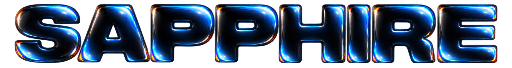
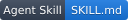
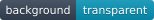
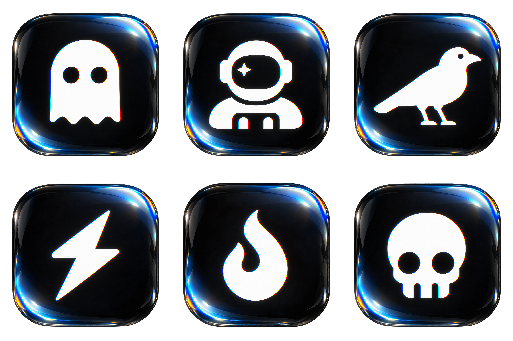
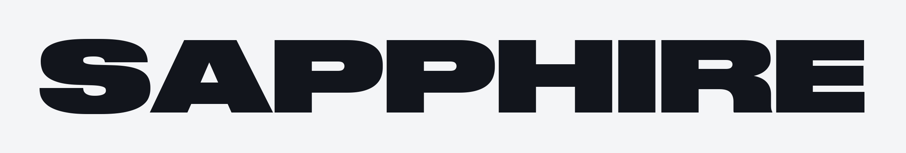
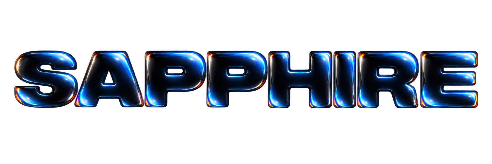

  

  
  
  
  
  

**Easily make optical glass typography, logos, icons, objects, illustrations and other visuals in the style of Apple's new iTunes icon.** Sapphire is an agent skill for creating artwork and assets with dark convex glass, lenticular refraction, and compact spectral highlights.

Ghost · Astronaut · Crow · Lightning · Flame · Skull

[Get started](#get-started) · [Visual examples](#visual-examples) · [How it works](#how-it-works) · [Outputs](#outputs)

## Get started

Add the complete `sapphire` folder to an assistant that supports agent skills, using that assistant's installation workflow. Keep `SKILL.md`, `agents/`, `references/`, and `assets/` together. You can also ask an assistant with file access to read [SKILL.md](SKILL.md) and follow it.

The assistant needs an image-generation or editing tool. Exact typography also needs access to the requested font; supplied logos and other marks work best with vector outlines or a clean alpha mask.

Then ask:

> Use Sapphire to create the word SAPPHIRE in Druk Wide Super. Typeset the actual font first, then apply the glass effect to the letterforms. Export a transparent PNG.

Or start from a shape:

> Use Sapphire to create a flowing ribbon symbol. Establish its silhouette first, then apply dark optical glass with compact cyan highlights and fine chromatic fringes. Keep the background transparent.

For existing artwork:

> Apply Sapphire to this logo. Preserve its silhouette, proportions, and cutouts. Export a transparent PNG with no enclosing tile.

Specify the subject, dimensions or aspect ratio, font when relevant, background, and output format. In assistants that support named skill invocation, use `$sapphire`.

## Visual examples

### Typography: silhouette to glass

The wordmark starts with **Druk Wide Super**, typeset from the actual font. The optical material is applied to the letters themselves, including the edges of their counters.

| Typeset silhouette | Sapphire treatment |
| --- | --- |
|  |  |

[Transparent wordmark PNG](assets/brand/sapphire-logo.png) · [Transparent silhouette PNG](assets/brand/sapphire-silhouette.png)

### Icons

The icon examples use a luminous white symbol inside a rounded-square optical lens. Typography, logos, and standalone objects use their own silhouettes as the glass surface.

[Transparent contact sheet](assets/examples/contact-sheet.png) · [512px icons](assets/examples/) · [Native masters](assets/examples/masters/)

## How it works

1. **Establish the silhouette.** Use supplied artwork, actual typeset lettering, or a newly generated clean shape. Preserve proportions, counters, and disconnected pieces.
2. **Apply the material.** Render dark convex glass with compact upper-right and lower-left caustics, selective cyan/blue versus red/amber fringes, and quiet interiors.
3. **Check the result.** Inspect geometry, spelling, spacing, highlight scale, and transparent edges on light and dark backgrounds.
4. **Export.** Keep a lossless master, honor the requested dimensions and format, and verify the alpha channel.

Sapphire is a set of instructions, references, and examples for an image-capable assistant. Rendering depends on the tools available in the host. Generative rendering can alter outlines; exact geometry requires a supported mask or a composition step that enforces the original silhouette.

## What you can make

| Graphic | Material treatment |
| --- | --- |
| Wordmarks and headlines | Glass letterforms using the requested font as the geometry reference |
| Logos and symbols | Glass applied to the supplied silhouette, preserving cutouts |
| App icons | A dark optical lens with a luminous central pictogram |
| Objects and illustrations | Material applied to selected forms while retaining the composition |
| Banners and layouts | A coherent lighting treatment across the requested arrangement and aspect ratio |

## Outputs

- **Transparent PNG:** real alpha outside the artwork and inside intended holes.
- **Lossless WebP:** a compact option when supported by the destination.
- **Native masters:** preserved at the actual generated resolution.
- **Contact sheets:** multiple assets on one transparent canvas when requested.

The bundled contact sheet is **3840 × 2560**. Each icon has a **1254 × 1254** lossless master and a **512 × 512** WebP export. The wordmark PNG is **2172 × 724**, with genuine transparency. Raster artwork is not an editable vector.

## Reference

- [Core skill](SKILL.md)
- [Silhouette workflow](references/silhouette-workflow.md)
- [Typography and named fonts](references/typography.md)
- [Material rules and prompt recipes](references/style-and-prompts.md)
- [Export guidance](references/export.md)
- [Example assets](references/examples.md)

## Attribution

Keep the [third-party artwork notice](references/THIRD-PARTY-NOTICES.txt) with redistributed example icons and contact sheets. The wordmark uses Druk Wide Super; no font binaries are bundled. Use fonts and source artwork you have permission to use.
